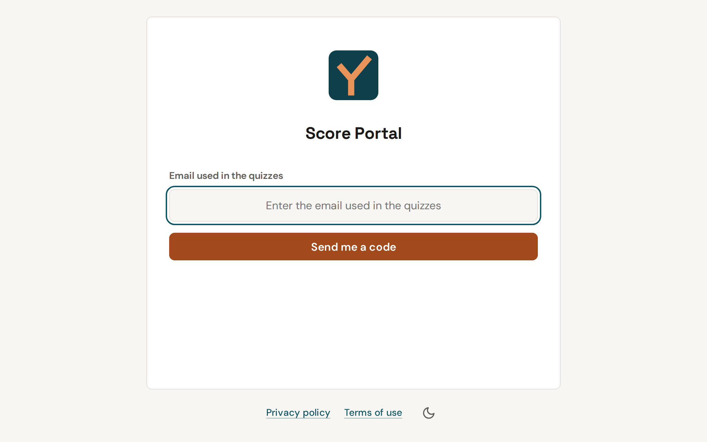
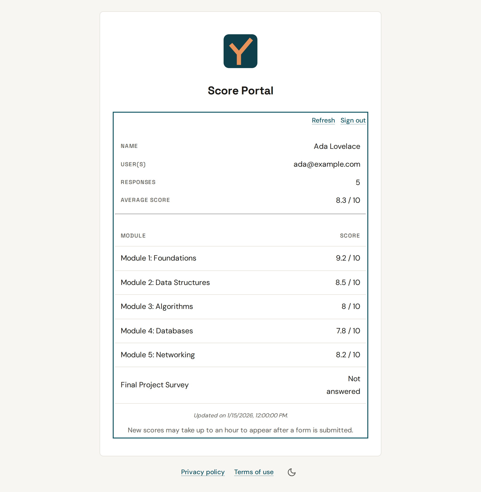
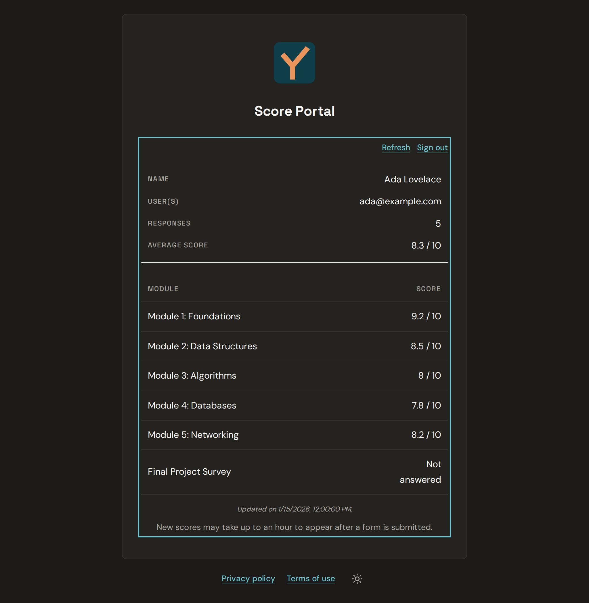
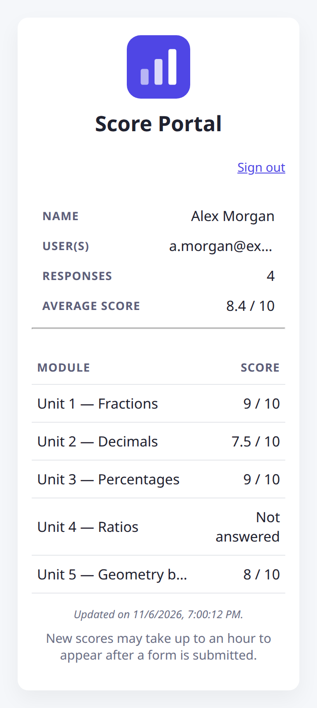

# Score Portal

A Google Apps Script web app that syncs Google Forms quiz scores into a spreadsheet and lets each respondent look up their own scores.

## Overview

- Discovers Google Forms in a Drive folder and links them to the spreadsheet.
- Synchronizes the scores of every respondent on a time-driven trigger, continuing across executions when the time limit is near.
- Stores the data in three tables (`Forms`, `Respondents`, `Scores`) and keeps a read-only `Overview` sheet with the people-friendly matrix.
- Serves a single-page web app that shows a respondent's scores.
- Runs in English or Brazilian Portuguese (`en`, `pt-BR`).

## Architecture

```text
 Google Forms ──► Sync (trigger) ──► Forms / Respondents / Scores tables ──► Overview sheet
                                                  │
 Respondent ──► Web app (SPA) ──► gas-webapp router ──► scores service ──────┘
```

- `src/app`, `src/domain`, `src/infra`: synchronization, Forms and Drive access, and the gas-sheetdb tables.
- `src/webapp`: entry points, router and scores service.
- `src/auth`: email one-time codes, sessions and the mailer ([ADR 4](docs/adr/0004-email-otp-access.md)).
- `src/web`: the single-page app (`portal.{html,css,ts}`), inlined into `src/generated/portal.html.ts` at build time.
- `src/shared/i18n`: message catalogue shared by the server and the page.

The decisions are recorded in [`docs/adr`](docs/adr).

## Setup

1. Install the dependencies with `npm ci`.
2. Copy `.clasp.example.json` to `.clasp.json` and `appsscript.example.json` to `appsscript.json`, then adjust them.
3. Run `npm run deploy:setup` to create the first deployment of the web app.
4. Open the spreadsheet and use the menu to set the settings and import Forms.

Later deployments are made by CI, not by the app.

## Configuration

Settings are stored in Script Properties and edited in the settings dialog, opened from the menu. Only the spreadsheet owner and editors can change them.

| Setting                  | Purpose                                                                                                |
| ------------------------ | ------------------------------------------------------------------------------------------------------ |
| `locale`                 | Language of the menu, messages and web app (`en` or `pt-BR`).                                          |
| `portalTitle`            | Title of the web app page.                                                                             |
| `primaryColor`           | Accent color as a hex code, for example `#4f46e5`.                                                     |
| `logoUrl`                | HTTPS address of a logo that replaces the built-in one.                                                |
| `faviconUrl`             | HTTPS address of the page icon.                                                                        |
| `driveFolderUrl`         | Folder searched for Forms to import.                                                                   |
| `formsTitleQuery`        | Only Forms whose title contains this text are imported.                                                |
| `formsFullTextQuery`     | Only Forms whose content contains this text are imported.                                              |
| `excludedFormUrls`       | Edit URLs of Forms to ignore, one per line.                                                            |
| `formTitleStripPatterns` | Case-insensitive regular expressions, one per line, removed from the Form titles shown to respondents. |

## Upgrading from the legacy app

The legacy app removed some words from the Form titles with hard-coded rules. That clean-up is now the `formTitleStripPatterns` setting, empty by default. To keep it, add one regular expression per line, for example:

```
^t4\s*[-–:]?\s*
checando a aprendizagem
```

## Limits

- Apps Script stops an execution after 6 minutes. The synchronization saves a cursor and schedules a continuation before the limit.
- Triggers and the web app are subject to the Apps Script daily quotas of the account that owns the script.
- `MailApp` limits the daily number of email recipients: 100 on consumer accounts and 1,500 on Google Workspace. The remaining quota is available from `MailApp.getRemainingDailyQuota()`. Each access code sent to a respondent uses one recipient, so the quota caps the sign-ins per day. When it is exhausted, requesting a code fails with a generic "try later" message and the failure is logged at `error`.
- Access codes: 3 requests per email and 50 in total per 15 minutes; a code lasts 10 minutes, allows 5 attempts and works once; a session lasts 30 minutes.

## Screenshots

Captured with sample data.

| Sign-in                                        | Results                                        |
| ---------------------------------------------- | ---------------------------------------------- |
|  |  |

| Dark mode                                       | 360 px                                                |
| ----------------------------------------------- | ----------------------------------------------------- |
|  |  |

## Testing

- `npm run check` runs formatting, lint, typecheck, the vitest suite (in-memory fakes) and the config check.
- `npm run test:gas:build` builds the Apps Script tests from `gas-test/` into one script, without running it.
- `npm run test:gas` runs them in real Apps Script. It needs a **dedicated** standalone test project: a run replaces the project's whole contents, so never use the dev script.
  1. Create the project and link it to a standard Google Cloud project.
  2. `clasp login --extra-scopes https://www.googleapis.com/auth/spreadsheets,https://www.googleapis.com/auth/script.storage,https://www.googleapis.com/auth/forms`
  3. Set `GAS_TEST_SCRIPT_ID` and `GAS_TEST_SPREADSHEET_ID` (see `.env.example`).

Tests create sheets named `__gt_<epochMs>_...` and delete them afterwards.

## CI

`npm run check` is the quality gate: formatting, lint, typecheck, the vitest suite and `gasdev check`. Deployment runs through the reusable workflow and the `gasdev setup` and `gasdev deploy` commands from the shared `gasdev` package.

### Deployment

`.github/workflows/deploy.yml` calls the reusable workflow in [`yorsh-co/gasdev`](https://github.com/yorsh-co/gasdev) (`@v3.0.0-beta.2`) on every push: `develop` deploys to the `dev` environment and `main` to `live`. Configure these GitHub environments:

| Environment | Variables                                                                                                                            | Secret         |
| ----------- | ------------------------------------------------------------------------------------------------------------------------------------ | -------------- |
| `dev`       | `GAS_SCRIPT_ID=1GmyVNNJAZe7MyZ-IQwoT7XpUiVYoL1Q03gw6_K7PrJabtU2ZftmTeb3n`, `GAS_DEPLOYMENT_ID` (the versioned web-app deployment ID) | `CLASPRC_JSON` |
| `live`      | Created later by `npm run deploy:setup` on the live sheet copy                                                                       | `CLASPRC_JSON` |

Create the `live` environment, restricted to the `main` branch with required reviewers, before the first push to `main`; otherwise GitHub auto-creates an empty `live` environment and the deploy fails.

See the [gasdev README](https://github.com/yorsh-co/gasdev#readme) for how to obtain `CLASPRC_JSON`, token expiry, and re-consent when the OAuth scopes change.

## License

[MIT](LICENSE.md)
